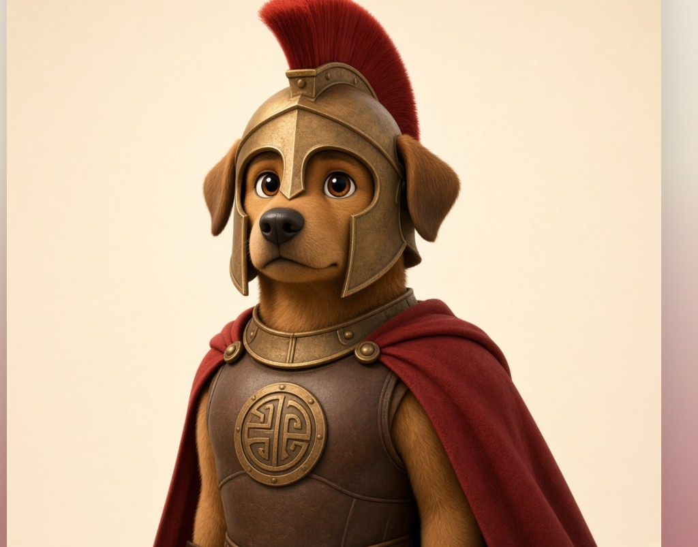
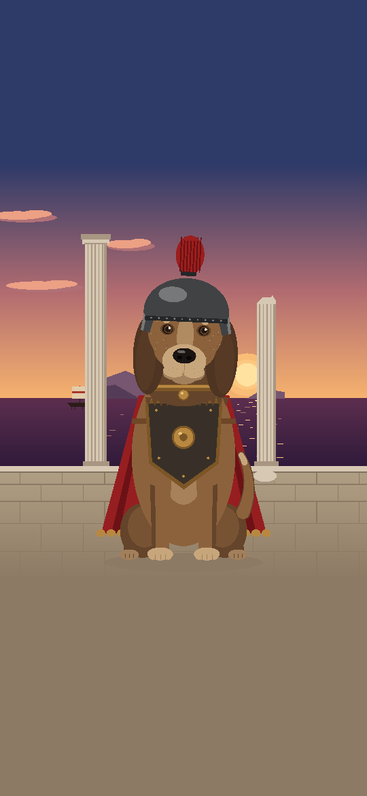

# Argo

<p align="center">
  
</p>

**FaceTime helper for people with low vision.** Call Argo, show a label, menu, bottle, or receipt to the camera, and ask in plain language. Argo answers out loud. When you want the words to keep, say **text me that** and a large-print, high-contrast PNG shows up in iMessage.

Built for **[HackUTA](https://hackuta.org)** (University of Texas at Arlington) on Chert FaceTime + a LiveKit agent.

**Live page:** [tonys-coding.github.io/HackUTA](https://tonys-coding.github.io/HackUTA/) — FaceTime button, cheat sheet, and Argo art.

---

## Mission

Make everyday reading less of a fight when eyesight is limited: medicine bottles, nutrition facts, prices on a menu, a letter on the table. Argo is meant to feel like a careful person on a FaceTime call, not a chatbot that dumps a wall of text you still cannot use.

## Elevator pitch

People with low vision still have to read the world. Phone magnifiers help, but you end up holding the camera, squinting at a tiny screen, and losing the words the second you put the phone down. Argo is a FaceTime number you call: show something, ask about it, get a short spoken answer, and optionally get a large-text image in Messages you can pinch-zoom and keep. Follow-ups stay on that call’s pictures, and later you can text Argo to recall something from a past FaceTime read.

## Inspiration

Named after Argos, the loyal dog who waited for Odysseus. The FaceTime face is that same idea: a steady companion on the call while you figure out what is in front of you. The iMessage handouts use high-contrast themes (cream, yellow, white, dark) aimed at WCAG-level contrast and common low-vision print practice (APH / Perkins-style palettes).

<p align="center">
  
</p>

<p align="center"><em>What callers see on FaceTime (portrait frame).</em></p>

---

## Try it (simplest path)

You do **not** need to install anything.

1. **FaceTime Video** call the Argo line your team is running (the number Chert shows for the active demo).
2. Wait for the greeting, then hold something up and ask, for example:
   - “Read this”
   - “How much sodium?”
   - “What are the ingredients?”
3. Optional: **“Text me that”** (or “text me the ingredients”) for a large-text image in Messages.
4. Optional theme: say **“change theme”**, then **cream**, **yellow**, **white**, or **dark**.
5. Say **stop** if you want Argo to quit talking mid-read.
6. After a call, **iMessage** the same line with a follow-up (“what was the caffeine?”) if the inbox poller is running on the demo machine.

NOTE: Someone on the team has to have `npm start` + `chert dev` running, or the call will not connect to Argo.

---

## What to say (cheat sheet)

| You say | Argo does |
| --- | --- |
| Read this / what is this? | Looks at the camera and answers |
| How much sodium? / ingredients? | Answers from the last pictures this call |
| Text me that | Sends a large-text PNG to iMessage |
| Text me the poem / ingredients | Sends the matching saved read |
| Change theme → cream / yellow / white / dark | Sets PNG contrast; sends a sample |
| Stop | Stops talking |

PNG themes land around **15:1–21:1** contrast (WCAG AA/AAA for text contrast). Pinch to zoom in Messages.

---

## Run the demo yourself (team)

Needs Node **22.23.2+** (or 24/26), LiveKit (or Chert shared LiveKit), ElevenLabs, Gemini, and a Chert FaceTime project.

```bash
git clone https://github.com/Tonys-Coding/HackUTA.git
cd HackUTA/sightline
npm install
cp .env.example .env.local   # fill in keys; chmod 600 .env.local
```

**Terminal 1 — agent**

```bash
cd sightline
npm start
```

**Terminal 2 — FaceTime slot**

```bash
cd sightline
npx @trychert/facetime@0.1.0-beta.21 dev --agent argo --minutes 60 --force --takeover
```

When it says Argo is in the waiting room, FaceTime Video the line it prints.

**Terminal 3 (optional) — iMessage recall**

```bash
cd sightline
npm run imessage:inbox
```

Fill `sightline/.env.local` from `.env.example`. Keep secrets out of git.

---

## How it works (short)

1. Chert answers FaceTime and bridges audio/video into a LiveKit room.
2. The **argo** agent greets, listens (ElevenLabs STT), and talks (TTS).
3. When you ask about what you are showing, Gemini reads a camera frame and Argo speaks a short answer.
4. On request, Argo renders a high-contrast PNG and sends it over Chert shared iMessage.
5. Each FaceTime call starts with a blank slate; finished calls are archived so later texts can recall past reads.

---

## Repo map

| Path | What it is |
| --- | --- |
| `docs/argo-portrait.jpg` | README portrait of Argo |
| `docs/argo.png` | FaceTime-style still |
| `sightline/` | Agent, vision, iMessage PNG + inbox |
| `avatar/` | On-call FaceTime face video |
| `server/` | Optional local API / event logging |

Default branch: **main**.

---

## HackUTA

This repo is our HackUTA project: a working FaceTime + iMessage demo for low-vision reading help, not a slide deck. If you are judging or trying the demo, use **Try it** above while a teammate keeps the agent warm.
